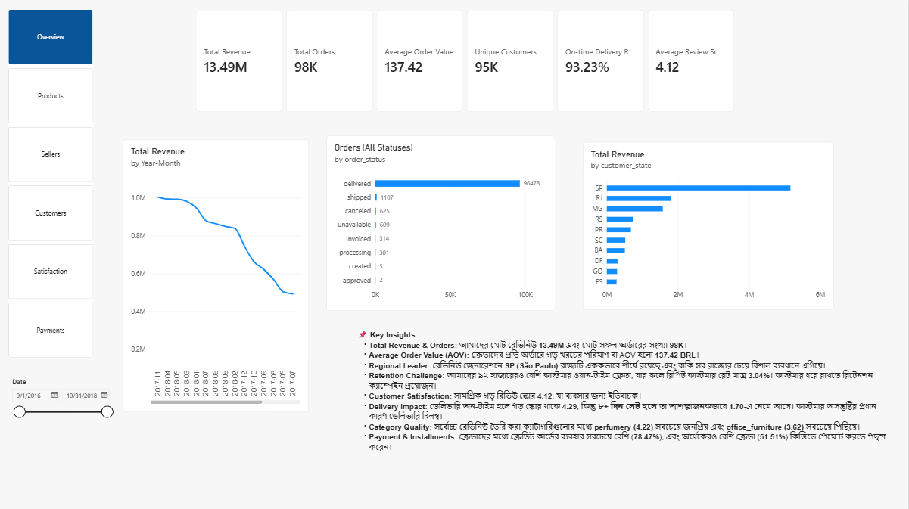

# CommerceIQ: E-commerce Business Intelligence

**PostgreSQL | SQL | Power BI | DAX | Data modelling**

An end-to-end analytics project on the Olist Brazilian e-commerce public dataset (99,441 orders, 2016-2018).
It covers the full workflow: raw CSV files, PostgreSQL database, data quality checks, cleaning, SQL analysis, a star-schema Power BI model and a 6-page dashboard, with every KPI validated against SQL.

Portfolio page: https://mavenshowcase.com/project/58011

> This is a public learning dataset, not a real company's internal data. Findings are illustrative.

## Business questions

- Which products, categories and sellers perform best?
- How many orders arrive on time, and how late are the others?
- Which customers buy again?
- How do delivery, payments and reviews relate?
- Where could the business improve?

## Dashboard (6 pages)

| Page | Focus |
|---|---|
| Overview | Revenue, orders, AOV, customers, on-time delivery, review score; monthly trend, order status, revenue by state |
| Products | Items sold, average item price, top category; revenue and quantity by category, top 10 products |
| Sellers | Seller count, revenue and orders per seller, delivery rate; top sellers, ranking, delivery by state |
| Customers | Unique customers, repeat rate, orders and spend per customer; customers by state, new vs repeat, purchase frequency |
| Satisfaction | Average score, low-rating rate, review count; score distribution, score by delivery delay, rating by category |
| Payments | Payment value, average payment, cancellation and installment rates; payment mix, cancellation trend |

Screenshots: `powerbi/screenshots/` (01_overview.png to 06_payments.png).



## Key findings

| # | Finding | Evidence |
|---|---|---|
| 1 | Late delivery goes together with low ratings | Average score 4.29 on time vs 1.70 when 8+ days late |
| 2 | Delays concentrate in a few states | Late rate AL 21.4%, MA 17.4% vs SP 4.5% |
| 3 | Revenue is concentrated | Top 10% of sellers earn 67.5%; SP contributes 38.3% |
| 4 | Few customers return | 96.96% bought once; repeat rate 3.04% |
| 5 | Satisfaction is high overall | Average 4.12; 13.87% of reviews are 1-2 stars |
| 6 | Credit cards dominate payments | 78.5% of payment value; 51.5% of orders use installments |
| 7 | Demand peaks in November 2017 | Revenue +52.1% month over month |

Headline numbers: 13.49M BRL revenue, 98,199 valid orders, average order value 137.42 BRL, 94,983 customers.
Full evidence and recommendations: [docs/business_insights.md](docs/business_insights.md).
These are associations in historical data, not proof of cause.

## Tech stack

PostgreSQL 17, SQL (CTEs, window functions: RANK, ROW_NUMBER, LAG, LEAD, NTILE), Power BI Desktop, DAX, Git.

## Repository structure

```
commerceiq/
├── data/
│   └── README.md                 # where to download the CSV files
├── sql/
│   ├── 01_create_database.sql    # database and schemas (raw, analytics)
│   ├── 02_create_tables.sql      # raw tables, keys, relationships
│   ├── 02b_import_data.sql       # loads the 8 CSV files
│   ├── 03_data_quality_checks.sql
│   ├── 04_cleaning.sql           # analytics layer (facts and dimensions)
│   ├── 05_business_analysis.sql  # 13 business questions
│   └── 06_create_views.sql       # Power BI-ready views
├── powerbi/
│   ├── CommerceIQ.pbix
│   ├── 01_date_table_and_page1_measures.dax
│   └── screenshots/
├── docs/
│   ├── data_dictionary.md
│   ├── data_model.png
│   ├── business_insights.md
│   └── kpi_validation.md
└── README.md
```

## How to reproduce

1. Download the dataset from Kaggle (link below) and place these 8 files in `data/`: customers, orders, order_items, order_payments, order_reviews, products, sellers, product_category_name_translation. The geolocation file is not used.
2. Run the scripts **from the project root**, in order:

```
psql -U postgres -f sql/01_create_database.sql
psql -U postgres -d commerceiq -P pager=off -f sql/02_create_tables.sql
psql -U postgres -d commerceiq -P pager=off -f sql/02b_import_data.sql
psql -U postgres -d commerceiq -P pager=off -f sql/03_data_quality_checks.sql
psql -U postgres -d commerceiq -P pager=off -f sql/04_cleaning.sql
psql -U postgres -d commerceiq -P pager=off -f sql/05_business_analysis.sql
psql -U postgres -d commerceiq -P pager=off -f sql/06_create_views.sql
```

3. Open `powerbi/CommerceIQ.pbix` and, if needed, point the data source to your local PostgreSQL (server `localhost`, database `commerceiq`) and refresh.

## Data model (Power BI star schema)

| From (one) | To (many) | Key |
|---|---|---|
| dim_customer | fact_orders | customer_unique_id |
| fact_orders | fact_order_items | order_id |
| fact_orders | fact_payments | order_id |
| dim_product | fact_order_items | product_id |
| dim_seller | fact_order_items | seller_id |
| DimDate | fact_orders | purchase_date |

Diagram: `docs/data_model.png`. Column details: [docs/data_dictionary.md](docs/data_dictionary.md).

## Metric definitions

| Term | Definition |
|---|---|
| Valid order | Status is not canceled or unavailable and the order has at least 1 item |
| Revenue | Sum of item price for valid orders. Freight is kept separate; payment value is not used as revenue |
| On-time delivery | Among delivered orders with a delivery date (96,470): delivered date is not after the estimated date |
| Unique customer | Distinct customer_unique_id with at least 1 valid order |
| Repeat customer | Unique customer with more than 1 valid order |
| Cancellation rate | Canceled orders / all orders |

## Data quality highlights

- 789 review IDs are reused across orders; 547 orders have more than one review (kept one per order, latest answer).
- 2,961 orders have several payment rows; payments were summed per order before joining.
- 775 orders have no items; 8 delivered orders have no delivery date.
- 610 products have no category; 2 categories were missing from the translation file and were added manually.
- 303 orders have a payment total that differs from item price plus freight, which is why payment value is not used as revenue.


## Limitations

- No cost data, so no profit or margin analysis.
- 2016 and the last months of 2018 have few orders; trends use 2017-01 to 2018-08.
- An order can have several payment types and several sellers, so type- and seller-level counts do not add up to the order total.
- Customers are identified by customer_unique_id; the dataset may under-identify returning buyers.
- Public 2016-2018 data from the Brazilian market.

## Dataset attribution and license

Data: Brazilian E-Commerce Public Dataset by Olist, published on Kaggle: https://www.kaggle.com/datasets/olistbr/brazilian-ecommerce
The dataset is not included in this repository. Use of the data is subject to the license shown on the Kaggle dataset page. All credit for the data goes to Olist.

## Author

Raihan
